### 김진원 · Jinwon

바이브 코딩으로 직접 만드는 프로덕트 디자이너. 
리서치로 문제를 정의하고, 화면을 설계하고, 돌아가는 것까지 만듭니다.

#### Build

| repo | what | stack |
| --- | --- | --- |
| [undertow](https://github.com/jinjwon/undertow) | Claude Code · Codex 중심의 데스크톱 코드 에디터 | TypeScript |
| [figmon](https://github.com/jinjwon/figmon) | 작업한 시간만큼 자라는 데스크톱 펫 | HTML |
| [wuwa-spire](https://github.com/jinjwon/wuwa-spire) | 팬메이드 덱빌딩 로그라이크 | HTML |
| [silent-dawn](https://github.com/jinjwon/silent-dawn) | 2인 협동 픽셀 판타지 RPG 프롤로그 | JavaScript |

#### Design

| project | role | scope |
| --- | --- | --- |
| VENDIT · 숙박 요금 관리 | 팀장 · Product Designer | 운영자 리서치 · 요금 결정 UX · Framer 프로토타입 |
| WALLA · 설문 제작 | Product Designer | 문제·가설 정의 · IA·User Flow · UT 설계 |
| GOGO · 체육대회 서비스 | 단독 UI/UX 디자이너 | 화면·인터랙션 설계 · 개발 협업 · QA·출시 대응 |
| PAWCE · 반려견 훈련 | 브랜딩 · 디자인 시스템 | 브랜드·공통 컴포넌트 · 화면 일관성 정리 |

[Portfolio ↗](https://free-surface-343720.framer.app/)
